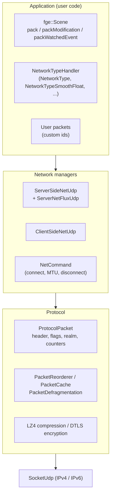
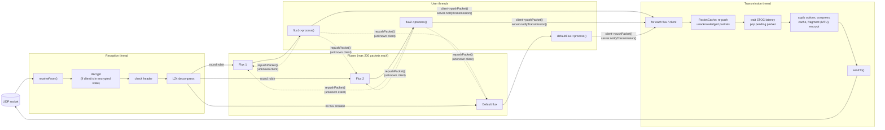
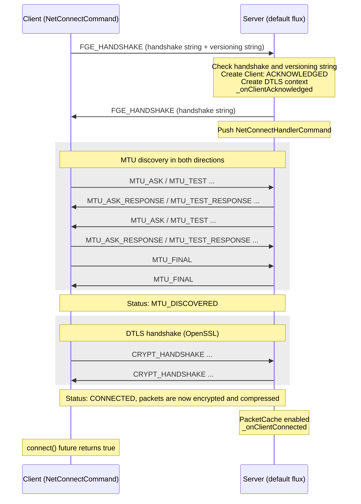
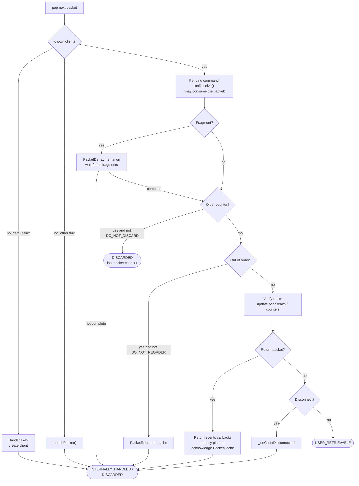

# FastEngine network architecture

This document describes how the UDP network layer of FastEngine is organized: threads, fluxes,
packet protocol, connection process, reliability and scene synchronization.

All classes live in the `fge::net` namespace (`includes/FastEngine/network`, `sources/network`).

## Glossary

| Term | Meaning |
|------|---------|
| **Identity** | IP + port of a peer. Key used to identify a client everywhere. |
| **Flux** | Queue of received packets with its own client list, processed by one user thread. |
| **Default flux** | The only flux that accepts new clients, and the fallback for unclaimed packets. |
| **Net command** | Internal state machine run per client: connect, MTU discovery, disconnect. |
| **MTU** | Biggest datagram size between two peers. Bigger packets are fragmented. |
| **Counter / reordered counter** | Per-packet sequence numbers used to detect lost, old and out of order packets. |
| **Realm** | "Generation" of the synchronized state. Older realm packets are ignored by the client. |
| **Return packet** | Packet sent periodically by the client: return events, latency data and acknowledgments. |
| **Return event** | Client action (simple, object, full update request, custom) carried by a return packet. |
| **Packet cache** | Server side store of sent packets, retransmitted until acknowledged. |
| **CTOS / STOC** | Client to server / server to client latency, in ms. |
| **RTT** | Round trip time, measured by the `OneWayLatencyPlanner`. |

## Layers overview



| Class | Role |
|-------|------|
| `SocketUdp` | Thin wrapper over the OS UDP socket (IPv4 or IPv6). |
| `Packet` | Raw serialization buffer (`<<` / `>>` operators). |
| `ProtocolPacket` | A `Packet` with the FastEngine header, the sender `Identity`, a timestamp and send options. Used through `TransmitPacketPtr` / `ReceivedPacketPtr`. |
| `Identity` | IP + port of a peer, used as the key everywhere. |
| `Client` | State of one remote peer: latencies, counters, realm, pending packets queue, status, MTU, crypt info and a `ClientContext`. |
| `ClientContext` | Per-peer helpers: `PacketDefragmentation`, `PacketCache`, `PacketReorderer` and the `NetCommand` queue. |
| `ClientList` | Thread-safe map `Identity -> ClientSharedPtr`, with optional add/remove events. |
| `ServerSideNetUdp` | Server manager: owns the socket, the reception/transmission threads and the fluxes. |
| `ServerNetFluxUdp` | A packet queue + its own `ClientList`, processed by a user thread. |
| `ClientSideNetUdp` | Client manager: same thread model, but a single flux and a single remote peer (`_client`). |

## Threads and fluxes (server side)

`ServerSideNetUdp::start()` creates two internal threads. The user then processes packets from one or
more **fluxes**, usually one flux per user thread.



* **Reception thread**: receives a datagram, decrypts it if the sender is a known client in an encrypted
  state, validates the header, decompresses it, then pushes it into a flux. Fluxes are tried in a
  round robin way. If every flux is full, the packet is dropped. If no flux was created, everything
  goes to the default flux.
* **Fluxes**: a flux only handles the clients in its own `_clients` list. When a flux receives a packet
  from a client it does not know, it gives the packet back to the server (`repushPacket()`), which sends
  it to the next flux. A packet has a limited lifetime: once it went through every flux without being
  claimed, it ends up in the default flux. **Unknown clients (new connections) are only accepted by the
  default flux.** A client can then be moved to another flux with `ClientList::moveTo()`.
* **Transmission thread**: wakes up on `notifyTransmission()` or every 10 ms. For each client it lets the
  `PacketCache` re-push expired packets, then sends **at most one packet per client per STOC latency**
  (server to client latency). This acts as a simple rate limiter.

> [!IMPORTANT]
> On the server, client timeouts, disconnections and **net commands (the whole connection process)** are
> updated inside `ServerNetFluxUdp::process()`. A flux that is never processed never connects its clients,
> so the default flux must always be processed, even if every client is moved to other fluxes afterwards.

### Thread safety

* `Client::pushPacket()` and the `ClientList` methods are protected by a mutex and can be called from
  any thread. Iterating a `ClientList` requires holding its lock (`acquireLock()`).
* A flux must be processed by a single thread at a time.
* After pushing packets, call `notifyTransmission()` to wake the transmission thread instead of waiting
  for its 10 ms timeout.

## Client side

`ClientSideNetUdp` uses the same model with a reception and a transmission thread, but it *is* the flux
(it inherits `NetFluxUdp`) and only talks to one peer: the server, stored in `_client`.

Differences with the server:

* Net commands (`connect()`, `retrieveMTU()`, `disconnect()`) are updated by the **transmission thread**,
  so the connection progresses even if the user does not call `process()` yet.
* `process()` checks the timeout, sends the return packet when needed (see
  [Return packets](#return-packets-and-acknowledgment)) and returns one packet. Options:
  * `OPTION_NO_TIMEOUT`: do not check the client timeout.
  * `OPTION_ONE_SHOT`: only pop and handle one packet, without timeout or return packet handling.
* `waitForPackets(time)` blocks until packets are available, useful for a client without a render loop.
* **`enableReturnPacket(true)` must be called once connected.** Without return packets, the server never
  receives acknowledgments and keeps retransmitting (see [Packet cache](#packet-cache-retransmission)).
* The reorderer cache size should be adapted to the server tick rate:

```cpp
auto connected = client.connect("my_game_v1");
if (connected.get())
{
    client.enableReturnPacket(true);
    client._client._context._reorderer.setMaximumSize(
            FGE_NET_PACKET_REORDERER_CACHE_COMPUTE(FGE_NET_DEFAULT_RETURN_PACKET_RATE.count(), SERVER_TICK_MS));
}
```

* `loopbackReturnPacket(handler)` builds the return packet and gives it directly to a
  `ReturnPacketHandler`, without the network. This is useful when the server and the client run in the
  same process (local host) and share the same return events code.

Like on the server, `fge::net::Socket::initSocket()` must be called once before using any socket, and
`fge::net::Socket::uninitSocket()` at the end.

## Packet format

Every datagram starts with an 8 byte header (`ProtocolPacket::Header`):

| Offset | Size | Field | Description |
|-------:|-----:|-------|-------------|
| 0 | 2 | `id` + flags | Lower 12 bits: packet id. Upper 4 bits: flags. |
| 2 | 2 | `realm` | "Generation" of the synchronized state (see [Realms](#realms)). |
| 4 | 2 | `counter` | Incremented for every packet sent to this peer. Reset on connection and on every realm change. |
| 6 | 2 | `reorderedCounter` | Incremented only for packets that can be reordered. |

Flags:

| Flag | Value | Meaning |
|------|-------|---------|
| `FGE_NET_HEADER_DO_NOT_DISCARD_FLAG` | `0x8000` | Never discarded because it is old. |
| `FGE_NET_HEADER_DO_NOT_REORDER_FLAG` | `0x4000` | Bypass the reorderer, delivered as soon as received. |
| `FGE_NET_HEADER_COMPRESSED_FLAG` | `0x2000` | Payload is LZ4 compressed. |
| `FGE_NET_HEADER_DO_NOT_FRAGMENT_FLAG` | `0x1000` | Never fragmented, even if bigger than the MTU. |

Packet ids:

* `1` to `1024` are reserved for internal ids (`InternalProtocolIds`): MTU discovery, fragments,
  FGE handshake, crypt (DTLS) handshake, return packet and disconnect.
* `1025` (`FGE_NET_CUSTOM_ID_START`) up to `FGE_NET_CUSTOM_ID_MAX` are free for the user. Ids must fit in
  12 bits, as the upper 4 bits are used by the flags.

Realm and counters are written by `Client::pushPacket()`. The user only sets the id (and flags):

```cpp
auto packet = fge::net::CreatePacket(MY_PROTOCOL_ID);
packet->doNotDiscard();          // optional flags
packet->packet() << someData;
client->pushPacket(std::move(packet));
server.notifyTransmission();
```

`ProtocolPacket::Options` can be added to `options()` so the transmission thread updates the packet
just before sending it (timestamp, full timestamp, latency corrector).

## Connection process

The connection is driven by **net commands** (`NetCommand`), small state machines stored in the client
`CommandQueue` and updated every `FGE_NET_CMD_UPDATE_TICK_MS` (30 ms).

* Client side: `ClientSideNetUdp::connect()` pushes a `NetConnectCommand` and returns a `std::future<bool>`.
* Server side: when the default flux receives a valid handshake from an unknown peer, it creates a
  `Client` and pushes a `NetConnectHandlerCommand`.



The versioning string (`ServerSideNetUdp::setVersioningString()`, max 32 characters) lets the server
refuse clients built with an incompatible version of the game.

Client network status (`ClientStatus::NetworkStatus`):

| Status | Set by | Meaning |
|--------|--------|---------|
| `UNKNOWN` | | Default. |
| `ACKNOWLEDGED` | engine | FGE handshake accepted. Only command packets are accepted. |
| `MTU_DISCOVERED` | engine | MTU known on both sides. Only command packets are accepted. |
| `CONNECTED` | engine | DTLS ready, user packets are delivered. |
| `AUTHENTICATED` | **user** | Free for the application, e.g. after a login packet. Set it only once `CONNECTED` (packets stay encrypted). |
| `DISCONNECTED` | engine | Disconnect packet received or `Client::disconnect()` called. |
| `TIMEOUT` | engine | No packet before the status timeout (2 s while connecting, 6 s once connected by default). |

Disconnection uses `ClientSideNetUdp::disconnect()` (a `NetDisconnectCommand`) or a
`NET_INTERNAL_ID_DISCONNECT` packet sent with `Client::disconnect()`.

## Encryption and compression

Encryption uses **DTLS** through OpenSSL, set up by the last step of the connection:

* Each side generates a self-signed RSA 2048 certificate when it starts (valid 24 h).
* The cipher is `ECDHE-RSA-AES256-GCM-SHA384`.
* Once the client is in the encrypted state, every packet pushed with `Client::pushPacket()` is marked
  for encryption, and the reception thread decrypts packets of known clients before reading the header.

LZ4 compression is only applied to packets sent in the encrypted state, before encryption (encrypted
data does not compress). The receiver checks `FGE_NET_HEADER_COMPRESSED_FLAG` to decompress it.

## Reception pipeline (`ServerNetFluxUdp::process()`)

Each call first runs `processClients()` (removes disconnected and timed out clients, updates commands),
then handles **one** packet:



The user loop simply calls `process()` until it returns `NONE_AVAILABLE`:

```cpp
fge::net::ClientSharedPtr client;
fge::net::ReceivedPacketPtr packet;
fge::net::FluxProcessResults result;
do
{
    result = flux->process(client, packet);
    if (result != fge::net::FluxProcessResults::USER_RETRIEVABLE)
    {
        continue;
    }

    switch (packet->retrieveHeaderId().value())
    {
    case MY_PROTOCOL_ID:
        // read packet->packet() with fge::net::rules
        break;
    }
} while (result != fge::net::FluxProcessResults::NONE_AVAILABLE);
```

The client side pipeline (`ClientSideNetUdp::process()`) is the same without the unknown client,
command and return packet steps. It also acknowledges every received packet for the next return packet.

### Reading packets safely

A received packet comes from the network and must never be trusted. Instead of reading with `>>`
directly, use the extraction rules from `fge::net::rules` (`FastEngine/manager/network_manager.hpp`).
They check the packet validity and the value at each step, and stop the chain at the first error:

```cpp
using namespace fge::net::rules;

std::string playerName;
uint8_t playerLevel;

auto const err = RStringRange(1, 32, packet->packet(), &playerName)
        .and_then([&](auto& chain) {
            return RRange<uint8_t>(1, 100, chain, &playerLevel);
        })
        .final();

if (err)
{
    // invalid packet, ignore it or disconnect the client
}
```

Available rules: `RValid`, `RRange`, `RMustEqual`, `RLess`, `RStrictLess`, `RSizeRange`,
`RSizeMustEqual`, `RStringRange`, `RStringMustEqual`, `RMustValidUtf8`. `and_for_each` can be used to
read a list whose size was extracted just before.

<a id="reliability"></a>
## Reliability

UDP gives no guarantee, so FastEngine adds a light reliability layer on top of it.

The layer is **not symmetric**: packets from the server to the client are acknowledged and retransmitted,
while packets from the client to the server are not (the client has no packet cache). Important client
data must be confirmed at the application level: the server answers, and the client repeats its packet
until it gets the answer. The `doNotDiscard()` flag does not help here, it only prevents a received
packet from being dropped as old.

<a id="return-packets-and-acknowledgment"></a>
### Return packets and acknowledgment

The client periodically sends a **return packet** (`NET_INTERNAL_ID_RETURN_PACKET`) to the server, every
`Client::getPacketReturnRate()` (500 ms by default). It contains:

1. **Return events** queued by the client code since the last return packet:
   * `simpleReturnEvent(id)` -> `_onClientSimpleReturnEvent`
   * `startObjectReturnEvent(cmd, parentSid, targetSid)` -> `_onClientObjectReturnEvent`
   * `askFullUpdateReturnEvent()` -> `_onClientAskFullUpdate`
   * `startComplexReturnEvent(id)` -> `_onClientReturnEvent` (custom payload)
2. The **latency planner** data (`OneWayLatencyPlanner`), used to compute the RTT, the CTOS/STOC
   latencies and the clock offset between the two computers.
3. The list of **acknowledged packets** (`counter`, `realm` labels) received since the last return packet.

<a id="packet-cache-retransmission"></a>
### Packet cache (retransmission)

Once a client is connected, every packet sent by the server is stored in its `PacketCache`. When a label
is acknowledged, it is removed from the cache. A packet that is not acknowledged after
`returnRate * 2.2 + RTT` is sent again, up to 3 times, then it is considered lost.

While a retransmission is in progress, `Client::isReadyToAcceptMorePendingPackets()` returns `false`.
The user should check it before pushing new update packets, to avoid flooding a slow client.

### Lost packets

Discarded old packets, missing counters and packets lost after all retries increase the client lost
packet count. When it reaches the threshold (15 by default), `Client::_onThresholdLostPacket` is called.

### Fragmentation

Packets bigger than the client MTU are split by the transmission thread into
`NET_INTERNAL_ID_FRAGMENTED_PACKET` fragments, and rebuilt by `PacketDefragmentation` on the other side.
Use `doNotFragment()` to disable it for a specific packet.

<a id="realms"></a>
## Realms

The **realm** is a 16 bit counter representing the "generation" of the synchronized state.
When the server sends a full state (for example `Scene::pack()` after a client asked for a full update),
it calls `Client::advanceCurrentRealm()`. Packets with an older realm are then ignored, so the client
never applies partial updates made for an older state.

The check is strict on the client side (packets from an older realm are discarded, unless they have the
`DO_NOT_DISCARD` flag), and tolerant on the server side: the server follows the realm sent by the client.
If a client keeps sending packets with a wrong realm for more than 2 s
(`FGE_SERVER_MAX_TIME_DIFFERENCE_REALM`), `ServerNetFluxUdp::_onClientBadRealm` is called.

## Scene and object synchronization

The network managers only move packets. The game state is synchronized by `fge::Scene` and the
**network types**.

* `NetworkTypeBase` wraps a pointer to a variable (through a `DataAccessor`), keeps a copy, and detects
  modifications. It keeps a modification flag **per client** (`PerClientSyncContext`), so each client only
  receives what changed since its last update.
* Specialized types exist: `NetworkType<T>` (trivial types), `NetworkTypeSmoothFloat` /
  `NetworkTypeSmoothVec2Float` (only applied above an error threshold), `NetworkTypeProperty`,
  `NetworkTypePropertyList`, `NetworkTypeVector`, `NetworkTypeEvents`, `NetworkTypeManual`,
  `NetworkTypeScene`, `NetworkTypeTag`.
* `NetworkTypeHandler` groups them. Every `Object` has one (`_netList`), and the `Scene` has its own.

| Server side | Client side | Use |
|-------------|-------------|-----|
| `Scene::pack(pck, id)` | `Scene::unpack(pck)` | Full scene state (new client, full update request). |
| `Scene::packModification(pck, id)` | `Scene::unpackModification(pck, range)` | Only modified network types, for this client. |
| `Scene::packWatchedEvent(pck, id)` | `Scene::unpackWatchedEvent(pck)` | Scene events (object created / deleted, ...). |
| `Scene::unpackNeededUpdate(pck, id)` | `Scene::packNeededUpdate(pck)` | Client asks explicit updates for some objects. |

`Scene::clientsCheckup(clients)` must be called so the scene knows which clients exist (to create or
remove their per-client sync data).

A typical server tick:

```cpp
mainScene.clientsCheckup(clients);

auto lock = clients.acquireLock();
for (auto it = clients.begin(lock); it != clients.end(lock); ++it)
{
    auto& client = it->second;
    if (!client->isReadyToAcceptMorePendingPackets())
    {
        continue;
    }

    auto packet = fge::net::CreatePacket(MY_UPDATE_ID);
    client->_latencyPlanner.pack(packet);
    mainScene.packModification(packet->packet(), it->first);
    mainScene.packWatchedEvent(packet->packet(), it->first);
    client->pushPacket(std::move(packet));
}
server.notifyTransmission();
```

A complete working example is available in `examples/clientServerLifeSimulator_004`.

## Current limitations

* Client to server packets are not retransmitted (see [Reliability](#reliability)). A lost return packet
  also loses its return events.
* The DTLS certificates are self-signed and not verified: the traffic is encrypted, but a client cannot
  be sure it talks to the real server (no protection against a man in the middle).
* Counter overflow is not handled yet (`TODO` in `PacketReorderer::checkStat()`). `counter` is reset on
  every realm change, but `reorderedCounter` is not: after 65535 reorderable packets sent to the same
  peer, the next ones may be considered old and discarded.
* `ServerSideNetUdp::sendTo()` (sending without a `Client`) uses a separate transmission queue that is
  marked as possibly removed in the code. It skips the client latency, the cache and the encryption.

## Main constants

| Constant | Default | Description |
|----------|---------|-------------|
| `FGE_SERVER_DEFAULT_MAXPACKET` | 200 | Max packets queued in a flux. |
| `FGE_SERVER_PACKET_RECEPTION_TIMEOUT_MS` | 250 ms | Reception thread `select()` timeout. |
| `FGE_SERVER_MAX_TIME_DIFFERENCE_REALM` | 2000 ms | Delay before a bad realm is reported. |
| `FGE_NET_CMD_UPDATE_TICK_MS` | 30 ms | Net commands update tick. |
| `FGE_NET_CONNECT_TIMEOUT_MS` | 1000 ms | Connect command timeout. |
| `FGE_NET_MTU_TIMEOUT_MS` / `FGE_NET_MTU_TRY_COUNT` | 400 ms / 12 | MTU discovery. |
| `FGE_NET_STATUS_DEFAULT_TIMEOUT` | 2000 ms | Client timeout while connecting. |
| `FGE_NET_STATUS_DEFAULT_CONNECTED_TIMEOUT` | 6000 ms | Client timeout once connected. |
| `FGE_NET_DEFAULT_RETURN_PACKET_RATE` | 500 ms | Return packet rate. |
| `FGE_NET_PACKET_CACHE_DELAY_FACTOR` | 2.2 | Retransmission delay factor. |
| `FGE_NET_DEFAULT_LOST_PACKET_THRESHOLD` | 15 | Lost packets before `_onThresholdLostPacket`. |
| `FGE_NET_MAX_VERSIONING_STRING_SIZE` | 32 | Max versioning string length. |

For debugging, `FGE_ENABLE_SERVER_NETWORK_RANDOM_LOST` / `FGE_ENABLE_CLIENT_NETWORK_RANDOM_LOST` simulate
around 1% packet loss, and `FGE_ENABLE_PACKET_DEBUG_VERBOSE` prints fragmentation details.
